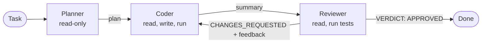

# 🤖 Coding Agents

A **multi-agent coding assistant**. Give it a task in plain English; a **Planner**, a **Coder** and a **Reviewer** (all powered by [Claude](https://www.anthropic.com)) collaborate inside a sandboxed workspace folder until the code is written, tested and approved.

```text
$ coding-agents "Build a CLI todo app with add/list/done commands and tests"

🔁 round 1/3
🧭 planner finished: 1. Create todo.py with a JSON-backed TodoStore ...
  🛠️  coder: write_file {'path': 'todo.py', ...}
  🛠️  coder: write_file {'path': 'test_todo.py', ...}
  🛠️  coder: run_command {'command': 'python -m pytest -q'}
🛠️  coder finished: Implemented todo.py and tests; all 6 tests pass.
  🔍 reviewer: run_command {'command': 'python -m pytest -q'}
🔍 reviewer finished: VERDICT: APPROVED

APPROVED   Rounds used: 1
```

## Table of contents

- [How it works](#how-it-works)
- [Quick start](#quick-start)
- [CLI options](#cli-options)
- [Use as a library](#use-as-a-library)
- [Design notes](#design-notes)
- [Safety](#safety)
- [Project layout](#project-layout)
- [Testing](#testing)
- [Limitations and roadmap](#limitations-and-roadmap)
- [Contributing](#contributing)

## How it works



| Agent | Tools | Job |
|---|---|---|
| **Planner** | `list_files`, `read_file` | Turns the task into a short numbered plan, no code |
| **Coder** | `list_files`, `read_file`, `write_file`, `run_command` | Implements the plan, writes tests, runs them, fixes failures |
| **Reviewer** | `list_files`, `read_file`, `run_command` | Reads the code, runs the tests, ends with `VERDICT: APPROVED` or `VERDICT: CHANGES_REQUESTED` plus fixes |

The Coder and Reviewer repeat until the Reviewer approves or `--max-rounds` is reached. Reviewer feedback is passed to the Coder on the next round.

## Quick start

**Requirements:** Python 3.10+ and an [Anthropic API key](https://console.anthropic.com).

```bash
git clone <your-repo-url> && cd coding-agents
python -m venv .venv && source .venv/bin/activate    # Windows: .venv\Scripts\activate
pip install -e ".[dev]"
pip install pytest                                   # the agents run tests inside the workspace

export ANTHROPIC_API_KEY=sk-ant-...                  # Windows cmd: set ANTHROPIC_API_KEY=...
coding-agents "Write a Python function to validate IBANs, with tests" --workspace ./out
```

The finished project is in `./out`.

### Docker (recommended for untrusted tasks)

```bash
docker build -t coding-agents .
mkdir -p out
docker run --rm -e ANTHROPIC_API_KEY=sk-ant-... -v "$PWD/out:/workspace" \
  coding-agents "Build a URL shortener with tests"
```

## CLI options

| Flag | Default | Description |
|---|---|---|
| `task` | required | What to build |
| `-w, --workspace` | `./workspace` | Folder the agents read and write |
| `-m, --model` | `claude-sonnet-5-5` (or `ANTHROPIC_MODEL`) | Claude model ID |
| `--max-rounds` | `3` | Max Coder/Reviewer rounds |
| `--max-steps` | `20` | Max tool calls per agent turn |

Exit code is `0` if the Reviewer approved, `1` if the round limit was reached, `2` for configuration errors.

## Use as a library

```python
from coding_agents import Orchestrator
from coding_agents.llm import ClaudeLLM

orch = Orchestrator(ClaudeLLM(), workspace="./out", max_rounds=3,
                    on_event=lambda agent, kind, detail: print(agent, kind, detail[:80]))
result = orch.run("Implement a LRU cache class with tests")
print(result.approved, result.rounds)
print(result.review)
```

Any object with `complete(system, messages, tools) -> Reply` works as an LLM, so you can plug in another provider or a scripted fake for tests.

## Design notes

- **Separation of duties.** The Reviewer physically cannot write files, so it cannot "fix" its own findings or hide failures. Tool access is enforced per role in code, not just in the prompt.
- **Strict verdict parsing.** Only a final `VERDICT: APPROVED` line counts. A missing or ambiguous verdict is treated as *not approved*.
- **Bounded loops.** Every agent turn has a step limit, every command has a timeout, and the whole run has a round limit.
- **Errors go back to the model.** A failed tool call returns `ERROR: ...` so the agent can adapt instead of crashing the run.
- **Testable without an API.** The whole pipeline is covered by tests using a scripted LLM.

## Safety

File tools are confined to the workspace (path escapes such as `../x` and absolute paths are rejected), and `run_command` only launches an allowlist of programs (`python`, `pytest`, `ruff`, `node`, `npm`) with no shell and a timeout.

**This is not a full sandbox.** Generated code run with `python` can do anything your user account can. For anything you do not fully trust, run inside Docker or a VM and keep secrets out of the environment.

## Project layout

```
src/coding_agents/
  llm.py           LLM protocol, Reply type, Claude backend
  tools.py         Workspace-confined tools (list/read/write/run)
  agents.py        Agent: one role, one tool subset, one tool-use loop
  orchestrator.py  Planner/Coder/Reviewer prompts and the review loop
  cli.py           `coding-agents` command
tests/             pytest suite using a scripted LLM (no network needed)
```

## Testing

```bash
pytest -q
ruff check .
```

CI runs both on Python 3.10 and 3.12 for every push to `main` and every pull request.

## Limitations and roadmap

- Agents run sequentially; no parallel agents yet.
- Whole workspace is not summarized, so very large projects can exceed the model context.
- No `edit_file` / diff tool yet: files are rewritten in full.
- No cost or token tracking.

Ideas: parallel specialist agents (frontend, backend, docs), a diff-based edit tool, git commits per round, token budget limits, a web UI that streams agent events.

## Contributing

1. Fork and create a feature branch.
2. `pip install -e ".[dev]"`
3. Add tests with your change; keep `ruff check .` and `pytest` green.
4. Open a pull request describing the change and how you tested it.

## License

Add a `LICENSE` file of your choice (MIT is a common default) before publishing.
